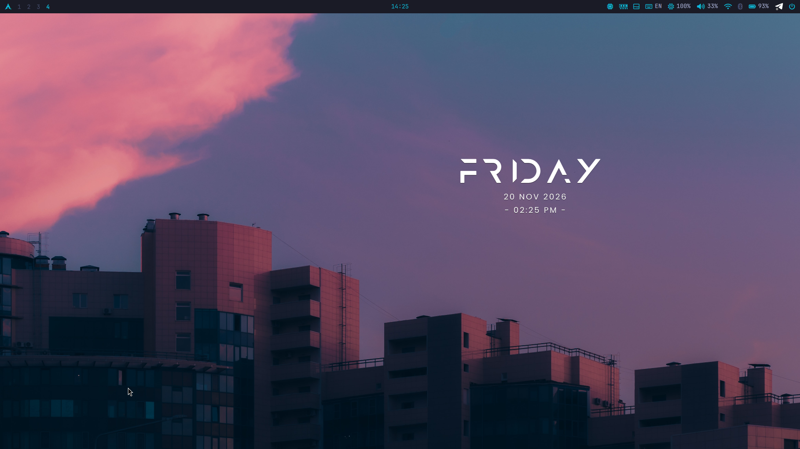

# krmv-setup

<p align="center">
  
</p>
<p align="center"><em>Tokyo Night desktop · one command to install · one command to switch DNS.</em></p>

My complete Arch Linux desktop in **one command**: Hyprland, a Quickshell bar with notifications, rofi, kitty,
a lock screen, an SDDM login theme and a zsh setup. Everything uses the same Tokyo Night colors and square corners.

```bash
git clone https://github.com/iskrmv/krmv-setup.git
cd krmv-setup
bash install.sh
```

Run it as a normal user (it asks for `sudo` when needed). On a fresh Arch install, run `sudo pacman -Syu` first.
Reboot afterwards and choose the **Hyprland** session in SDDM.

## Why this exists

> [!IMPORTANT]
> **I am lazy. That is exactly why this exists.**
> I do not want to fix the same thing twice, so I built a desktop that sets itself up in one command and
> keeps every setting one keypress away. Laziness is not the enemy of good work, it is the reason for it.

> *"Laziness: the quality that makes you go to great effort to reduce overall energy expenditure."*
> — **Larry Wall**, creator of Perl (*Programming Perl*)

This repository is my own Arch setup, kept as a single source of truth. It is deliberately opinionated:
one Tokyo Night palette, square corners, the same key names on every monitor, and **one installer**.
The README you are reading is the whole manual — there is no second README, no separate DNS project and
no hidden step you have to remember. If you change something by hand and it turns out to be useful, put
it back in the repo and run `bash install.sh` again; the installer is safe to re-run and backs up files
it replaces.

Three rules keep the laziness honest:

1. **Install once.** `bash install.sh` installs the desktop, packages, themes, the `dns` command, wallpapers
   and config files. `SKIP_*=1` variables skip a part when you want to.
2. **Change without rebuilding.** Shortcuts, default apps, widgets, night mode, location permissions and
   audio outputs all live in `SUPER + I`. Your choices are stored in `~/.local/state/krmv-setup/`, so a
   re-run of the installer does not erase them.
3. **Keep an escape hatch.** Every DNS switch is reversible with `dns stop`, every old config is backed up,
   and `sudogui --check` / `hyprctl configerrors` tell you what is wrong instead of leaving you to guess.

## What you get

| Part | What it does |
| --- | --- |
| **Hyprland** (Lua config) | Split into small files: `conf/display.lua`, `input.lua`, `autostart.lua`, `keybinds.lua`, `env.lua` |
| **Quickshell bar** | Workspaces, clock with calendar on hover, CPU / RAM / disk details on hover, volume and brightness with sliders, Wi-Fi / Ethernet status, Wi-Fi and Bluetooth panels (connect, pair, passwords), battery (live via UPower: hover shows charge, time to full / time left, power draw and health), tray icons, power button. Only one hover popup is open at a time |
| **Notifications** | Built into the bar. Every notification stays 10 seconds and shows a countdown line (hover pauses it). Click one to jump to that app's window; chat apps (Telegram, Discord, ...) get a reply box when they support it |
| **On-screen display** | Volume and brightness changes (Fn keys, scroll, sliders) show a small level indicator at the bottom center. It shows "Muted" when muted |
| **Media** | Any player that speaks MPRIS (Spotify, VLC, mpv, YouTube / Netflix / music in Chrome or Firefox): back / play-pause / next, the title and the time between the launcher and the clock. Hover for the full info and a seek slider |
| **Volume mixer** | Hover the volume icon: master slider; click the small arrow (bottom right) for one slider and mute per app. Every app with an audio stream is listed (Steam, Telegram, Discord, browsers...). Running apps that are silent at the moment are listed too, and their slider works: the volume is remembered and applied when the app starts making sound |
| **Settings** | `SUPER + I` opens a real **Settings app**: a sidebar (Display, Network, Sound, Input, Widgets, Privacy, Apps, System) with plain-language cards, switches and buttons; typing `settings` in the launcher opens the same app. The old rofi menu is only a fallback when the bar is not running (`KRMV_OLD_SETTINGS=1 sh ~/.config/hypr/scripts/settings.sh` forces it). Old description: (or type "settings" in the command launcher) opens one rofi hub: **default apps** (browser, files, terminal, editor, video, music, images, PDF, camera + a "More" mode for exact file types), **keyboard shortcuts**, **desktop widgets**, **display (resolution, scale, rotation, position, mirroring)**, **DNS (change / turn off)**, **location permissions**, **audio** and night mode. Everyone picks their own apps and keys |
| **Default apps** | `SUPER + E` opens your default file manager (yazi by default), `SUPER + B` your default browser, `SUPER + Return` your default terminal |
| **Info boxes** | Volume and brightness, the media keys (play / pause / next / previous) and the touchpad key show a small box at the bottom center, like Windows. The media box appears only for the keys, not when you click inside a player |
| **Clock app** | Timer, alarms (with days and labels) and a stopwatch. Click the clock in the bar or press `SUPER + C`. An alarm or a finished timer rings with a sound and a window (Enter dismisses, S snoozes 5 minutes). Alarms and the running timer are remembered after a restart |
| **Images** | [swayimg](https://github.com/artemsen/swayimg) is the default image viewer: tiny, native Wayland, opens nearly every format (PNG, JPEG, GIF, WebP, AVIF, HEIC, **SVG** via `librsvg`, TIFF, RAW, JXL). It gets a Tokyo Night `init.lua`. Edit-heavy work: open the file in Photoshop/GIMP from the viewer or yazi |
| **Night mode** | Open the brightness popup and click its small arrow: a night mode switch (blue light filter, `hyprsunset`) |
| **Terminal greeting** | `fastfetch` with the Tokyo Night theme greets you in zsh, bash and fish |
| **Keyboard / touchpad** | English + Russian by default. The bar chip shows the layout; **switching shows an info box**; click = next layout, **right-click = add / remove layouts** (any language). Touchpad: natural scrolling ON, speed `0.5`; USB mouse: normal scrolling. Over the volume/brightness chips two fingers up = more on a touchpad, wheel up = more on a mouse (the bar asks Qt which devices use natural scrolling) |
| **Editor** | Neovim with [LazyVim](https://www.lazyvim.org/) (the official starter, plugins pre-downloaded). `vim` is an alias for `nvim` |
| **Calculator** | [Arithmetic](https://github.com/armanmaurya/arithmetic) (Rust + Slint), installed by `install.sh`; the calculator key opens it floating in the middle of the screen |
| **Desktop clock** | The day in big stylized letters with the date and the time under it, same look as KDE's [Modern Clock](https://store.kde.org/p/2135653). Settings at the top of `DesktopClock.qml`. Extra net-speed and media cards can be switched on in `SUPER + SHIFT + W` |
| **Power menu** | Power icon in the bar: lock, log out, sleep, reboot, power off |
| **Lock screen** | `hyprlock`, themed. Locks automatically before sleep, so **closing the laptop lid locks the screen** (`hypridle`) |
| **kitty** | Tokyo Night terminal theme |
| **SDDM** | Login screen theme with your wallpaper |
| **zsh** | oh-my-zsh + powerlevel10k + autosuggestions + syntax highlighting (emacs keys, Alt+Backspace deletes a word) |
| **Dark mode** | GTK, Qt and websites follow the dark theme automatically |
| **Aliases** | `pacman` = `sudo pacman`, `yoink` = `yay -S`, `yeet` = `yay -Rns`, `yago` = `yay -Ss`, `sweep` = deep clean (see below) |
| **yay** | Installed automatically if it is missing |
| **DNS switcher** | `dns dns.adguard.com` switches the whole system to DNS-over-TLS. `dns status`, `dns test`, `dns stop` |
| **NetworkManager** | The standard Arch `networkmanager` package with `wpa_supplicant` and the `NetworkManager.service` enabled. Saved Wi-Fi profiles are switched to **autoconnect = yes** by `install.sh`; `SUPER + SHIFT + N` opens the Wi-Fi menu |
| **Root GUI apps** | `sudogui` tries Wayland, then XWayland. The password dialog is a polkit agent built into the Quickshell bar (`PolkitDialog.qml`, same theme as the bar; it falls back to `hyprpolkitagent` on an old Quickshell), and Qt apps use the Tokyo Night Qt palette (`qt6ct` / `qt5ct`), GTK apps the dark theme. From rofi it uses the graphical `pkexec` dialog, from a terminal `sudo`. `sudogui --check` explains what is missing |
| **Net speed** | Live `↓ / ↑` rates with a speedometer icon, in the top bar between the clock and the CPU icon, and as a desktop widget in the style of the big clock (no card, two big rows: download and upload). Every desktop widget can be dragged to its own place in the editor (`SUPER + SHIFT + W`, or double-click a widget); until you move it, it sits under the clock. Top bar and desktop card are **two separate switches**, both **off by default** (`SUPER + I` → Desktop widgets, or `SUPER + SHIFT + W`) |
| **Media output widget** | A separate "now playing" desktop card with cover art and a progress bar (**off by default**); the compact bar media line is always there between the launcher and the clock |
| **Color picker** | `SUPER + SHIFT + P` picks any pixel with `hyprpicker` and copies the hex value to the clipboard |
| **Camera** | `SUPER + SHIFT + O` opens `snapshot` (GNOME Camera, simple and dark-theme friendly) |
| **System monitor** | `btop` with the **TTY** color theme (uses your terminal's Tokyo Night colors) and the theme background **off**, written for your user **and root**. `SUPER + SHIFT + T` opens it |
| **Screenshots** | `grim` + `slurp`. `SUPER + SHIFT + S` **freezes the screen** (needs `imagemagick`; the mouse pointer is never in the picture) (hyprpicker draws an exact copy) while you select, and the selection overlay has no fade, so the picture is never tinted blue |
| **Animated wallpapers** | Drop `.mp4 .webm .mkv .mov .gif` files into `~/.config/hypr/wallpapers/animated`; `SUPER + W` cycles stills and animated ones. `mpvpaper` plays them silently and pauses when a fullscreen window covers it. Your last wallpaper is restored at login |
| **Location** | Settings → Location: GeoClue app permissions (`/etc/geoclue/geoclue.conf`). Pick an app to switch ALLOWED / DENIED, or add one by its desktop id. A GeoClue agent runs at login for apps not on the list |
| **Audio** | Settings → Audio: **"Laptop speakers too quiet?"** raises every hidden ALSA level (Master, Speaker, PCM...) to 100% and saves it; select an output; copy diagnostics |
| **Calendar reminders** | Click the clock → **Reminders** tab: pick a day, type `HH:MM` and a text, Enter. At that minute a notification pops up. Days with reminders get a dot in the hover calendar. Stored in `~/.local/state/krmv-setup/reminders.json` |
| **rofi launcher** | `ALT + SPACE`: **`Tab` switches between the app list and the list of command-line / terminal programs**; type letters and apps that **start** with them come first, looser guesses below (`len` → Lens... first, Blender after). For command-line / terminal tools type **`run <command>`** (`run btop`, `run tork`, `run nvim`): it opens in your terminal and waits for Enter when the command ends. A bare command name also works. Mistyped name → a clear red error box. Scrolling is right for touchpad **and** mouse (a small `rofi` wrapper handles it) |

| **yazi** | Preview pane and image previews are on by default (hidden files are off; press `.` in yazi to toggle them); everything opens with your default apps (`xdg-open`). Settings → Default apps → **More** picks an app per exact file type |

## The lazy guide (read this next time)

**New machine:** `git clone https://github.com/iskrmv/krmv-setup.git && cd krmv-setup && bash install.sh`, reboot, choose Hyprland. Done.

**"I forgot how to do X" cheat sheet**

| I want to... | Do this |
| --- | --- |
| Open an app | `ALT + SPACE`, type its first letters, Enter |
| Run a command-line tool | `ALT + SPACE`, press `Tab` for the command list (or type `run btop`), Enter |
| Switch between open windows | Hold `ALT`, tap `TAB` for the next one (`SHIFT + TAB` goes back), let go of `ALT` to switch. A quick tap = previous window |
| Go back to the classic password dialog | `SUPER + I` → Password dialog (themed / classic) |
| Change resolution, scale, rotation, screen position | `SUPER + I` → Display (12 seconds to confirm, otherwise it goes back) |
| Play 4:3 stretched on a 16:9 screen (CS2 and others) | Steam → game → Properties → Launch options: `krmv-stretch %command%` (once). Then `SUPER + I` → Display → Stretched resolution to switch it ON/OFF and pick the size (1440x1080, ...). Hyprland has no GPU stretch of its own, so this uses `gamescope -S stretch` |
| Stretch only ONE game / give one game its own size | Put the launch option on that game only. Own size: `KRMV_STRETCH=1280x960 krmv-stretch %command%`; never stretch it: `KRMV_STRETCH=off krmv-stretch %command%` |
| Mouse feels odd when I flick it fast | `SUPER + I` → Mouse for games (flat profile, no acceleration; the touchpad is not touched) |
| Use a resolution that is not in the list | `SUPER + I` → Display → Resolution and refresh rate → Custom resolution... |
| Change or turn off DNS | `SUPER + I` → DNS |
| Download torrents in the terminal | `ALT + SPACE`, `run tork` |
| See every shortcut | `SUPER + /` |
| Change a shortcut or a default app | `SUPER + I` |
| Add a keyboard layout | Right-click the `EN` chip in the bar |
| Pick a color from the screen | `SUPER + SHIFT + P` |
| Screenshot an area (screen freezes) | `SUPER + SHIFT + S` |
| Use an animated wallpaper | Copy a video/GIF into `~/.config/hypr/wallpapers/animated`, press `SUPER + W` until it shows |
| Media controls (bar popup and desktop widget) | Only what the player supports is shown: shuffle and repeat (Spotify, VLC), back / forward 10 s (YouTube, videos, podcasts), play / pause / next / previous, the player's own volume, and a button that brings its window to the front. A YouTube tab simply has no shuffle or repeat |
| Show net speed / media widget | `SUPER + I` → Desktop widgets |
| Move the clock, net speed or media widget | `SUPER + SHIFT + W`, drag each one, `Enter` saves, `R` resets all |
| Allow or block an app's location | `SUPER + I` → Location |
| Quiet laptop speakers | `SUPER + I` → Audio → "Laptop speakers too quiet?" |
| Add a reminder | Click the clock → Reminders |
| Free disk space | `sweep` (or `sweep --all`) |
| Check a desktop widget | `SUPER + I` → Desktop widgets shows `[ON]`/`[OFF]`; `qs -p ~/.config/hypr/theme/quickshell/shell.qml ipc call widgets status`; errors: `qs log -p ~/.config/hypr/theme/quickshell/shell.qml` |
| Find out why something is broken | `hyprctl configerrors`, `sudogui --check`, run `qs -p ~/.config/hypr/theme/quickshell/shell.qml` in a terminal |

**Where things live**

| What | Where |
| --- | --- |
| Hyprland config pieces | `~/.config/hypr/conf/*.lua` |
| Bar, widgets, notifications | `~/.config/hypr/theme/quickshell/*.qml` |
| Helper scripts | `~/.config/hypr/scripts/` |
| Your choices (alarms, reminders, layouts, widgets, wallpaper) | `~/.local/state/krmv-setup/` (never overwritten by the installer) |
| Old configs the installer replaced | `backup-<time>` folders and `*.bak-<time>` files |

**Golden habit:** when you fix something by hand, copy the fixed file back into this repo, commit, and the next install already has it.

**Things that depend on your hardware (check once)**

- Rofi scroll direction: if it feels reversed, delete the two `ml-row-*` lines in `theme/rofi/config.rasi`.
- Chrome / Electron scroll speed: the installer sets native Wayland flags; restart the browser once.
- Location needs working Wi-Fi geolocation (GeoClue); desktop PCs without Wi-Fi get no position.
- Blue-tinted screenshots: if they still happen, turn night mode off once and tell me.

## Shortcuts

Press **SUPER + /** at any time to see this list on screen.

| Keys | Action |
| --- | --- |
| `SUPER + /` | Show all shortcuts |
| `ALT + SPACE` | App launcher; type a command if the app is not listed |
| `SUPER + Return` | Terminal (kitty). The HP Omen key does the same |
| `SUPER + E` | Default file manager (yazi) |
| `SUPER + V` | Clipboard history |
| `SUPER + .` | Emoji picker |
| `SUPER + SHIFT + P` | Color picker (copy a hex value) |
| `SUPER + SHIFT + O` | Camera |
| `SUPER + SHIFT + T` | System monitor (btop, in the default terminal) |
| `ALT + TAB` | Hold ALT, tap TAB to walk the window list, release ALT to switch |
| `SUPER + SHIFT + A` | Choose an audio output |
| `SUPER + SHIFT + N` | Wi-Fi / NetworkManager menu (autoconnect, connect, list) |
| `SUPER + SHIFT + S` | Screenshot: select an area |
| `Print` | Screenshot: the focused monitor, instantly |
| `CTRL + Print` | Screenshot: all monitors, instantly |
| `CTRL + SHIFT + Print` | Screenshot: the focused window, instantly |
| `SUPER + I` | Settings (default apps, shortcuts, widgets, location, audio, night mode) |
| `SUPER + C` | Clock app: timer, alarm, stopwatch, reminders (also: click the clock) |
| `SUPER + B` | Default web browser |
| `SUPER + W` | Next wallpaper |
| `SUPER + SHIFT + W` | Desktop widget editor: move the clock, toggle net speed and media output, Enter saves, R resets, Esc cancels. Double-clicking the clock does the same |
| Calculator key | Calculator ([Arithmetic](https://github.com/armanmaurya/arithmetic)) |
| `SUPER + Q` | Close window |
| `SUPER + K` | Force kill the whole application (also Steam and Waydroid: apps can no longer hijack your shortcuts) |
| `SUPER + F` | Fullscreen |
| `SUPER + T` | Toggle floating |
| `SUPER + Arrow keys` | Move focus |
| `SUPER + SHIFT + Arrow keys` | Move the window |
| `SUPER + 1 ... 0` | Go to workspace 1-10 |
| `SUPER + SHIFT + 1 ... 0` | Move window to workspace 1-10 |
| `SUPER + left / right mouse drag` | Move / resize window |
| `SUPER + R` | Reload the Hyprland config |
| `SUPER + L` | Lock screen |
| `SUPER + SHIFT + E` | Log out |
| 4-finger swipe left / right (touchpad) | Switch workspace |
| Volume / brightness keys | Change volume and brightness (the bar updates instantly) |
| Media keys (Fn + play / pause / next / previous) | Control the player you used last |
| `ALT + SHIFT` | Switch keyboard layout (or click / right-click the layout chip in the bar) |

Power menu keys: `L` lock, `E` log out, `S` sleep, `R` reboot, `P` power off, `Esc` cancel.

## Install options

Environment variables for `install.sh`:

| Variable | Effect |
| --- | --- |
| `YES=1` | No questions from pacman (`--noconfirm`) |
| `SKIP_PACKAGES=1` | Do not install packages or yay |
| `SKIP_SDDM=1` | Do not touch SDDM |
| `SKIP_ZSH=1` | Do not touch zsh |
| `SKIP_NVIM=1` | Do not install LazyVim |
| `SKIP_DNS=1` | Do not install the `dns` command |

Example: `YES=1 bash install.sh`. The script is safe to run again. Your old files are never lost: they are saved as
`~/.config/hypr/backup-<date>/` and `<file>.bak-<date>`.

## Repository layout

```
install.sh              the installer
hypr/                   -> ~/.config/hypr
  hyprland.lua            main file, only require() calls
  hypridle.conf           lock before sleep / lid close
  conf/                   display, input, env, autostart, keybinds
  theme/
    quickshell/           the bar, notifications and power menu (QML)
    rofi/ kitty/ yazi/    linked to ~/.config/rofi, ~/.config/kitty and ~/.config/yazi
    btop/                 Tokyo Night btop theme (user + root)
    hyprlock/             lock screen theme
    gtk/ qt6ct/ portal/   dark mode settings
    theme.lua             gaps and borders
  scripts/                wallpaper, brightness, screenshot, clipboard, emoji, keys, focus-app, dark-mode,
                          color, layout, audio, network, launcher, run-in-terminal, sudogui, settings, sweep
  shell/                  aliases for bash / zsh / fish
  data/                   emoji list and the shortcut list
  wallpapers/desktop      still desktop wallpapers
  wallpapers/animated     videos and GIFs played by mpvpaper
  wallpapers/sddm         login screen wallpaper
docs/concept.png          the image shown at the top of this README
dns/dns                   the DNS-over-TLS switcher installed by install.sh
sddm/krmv-tokyo/        SDDM theme
zsh/zshrc               -> ~/.zshrc
```

## Customizing

- **Wallpapers:** put still images in `~/.config/hypr/wallpapers/desktop` and videos/GIFs in
  `~/.config/hypr/wallpapers/animated` (random one at login, `SUPER + W` for the next). `mpvpaper` handles the
  animated files, `swaybg` the stills. For the login screen put an image in `wallpapers/sddm` and run `bash install.sh` again.
- **Desktop clock:** the look and settings are in `hypr/theme/quickshell/ClockFace.qml` (`showDay`, `showDate`, `showTime`, `use24Hour`, `timeDecor`, `textColor`, `sizeScale`). To move it press `SUPER + SHIFT + W` (or double-click it), drag it, press Enter: the place is remembered in `~/.local/state/krmv-setup/clock-position`. The day name uses the Anurati font, which `install.sh` downloads from the original KDE widget's repository (it is free for personal use, so it is not stored in this repo); the rest uses Poppins.
- **Media in browsers:** works out of the box (Chrome, Firefox). For mpv install `mpv-mpris`.
- **Colors / font:** the `theme` block at the top of `hypr/theme/quickshell/shell.qml` (one `icon` color for every icon).
  The Quickshell bar reloads by itself when you save a file.
- **Hide a tray icon:** add a word to `trayHide` in `shell.qml`. Run `qs` in a terminal to see each tray item's id.
- **Scroll direction, trackpad speed:** `hypr/conf/input.lua` (touchpad natural scrolling ON, speed `0.5`;
  mouse normal). The brightness and volume chips intentionally use the opposite direction so two fingers up
  always increase the value. rofi is an X11 app, so its mouse-wheel rows are swapped in `hypr/theme/rofi/config.rasi`
  to match native Wayland apps. Chrome/Chromium get `--ozone-platform=wayland` flag files in `~/.config`
  so their scroll speed matches native Wayland apps.
- **Network:** the installer uses Arch's standard `networkmanager` package (`nmcli` + `wpa_supplicant`) and enables
  `NetworkManager.service`. Saved Wi-Fi profiles get `connection.autoconnect=yes` automatically; you can redo this
  any time with `SUPER + SHIFT + N` or `sh ~/.config/hypr/scripts/network.sh autoconnect`. If you had no saved Wi-Fi
  yet, connect once through the menu and autoconnect is set for that network too.
- **File manager:** `hypr/theme/yazi/yazi.toml` keeps hidden files, the preview pane and image previews on.
- **System monitor theme:** `hypr/theme/btop/krmv.theme` is installed for your user and for root. In a real TTY
  btop always uses its built-in 16-color theme (upstream has no separate TTY theme key).
- **Shortcuts:** `hypr/conf/keybinds.lua`. Keep `hypr/data/shortcuts.txt` in sync, it feeds `SUPER + /`.
- **Idle lock (lock after N minutes):** uncomment the `listener` block in `hypr/hypridle.conf`.
- **HP Omen key:** bound to `XF86Launch2` (the kernel's name for it). If it does nothing on your model, run `sh ~/.config/hypr/scripts/find-key.sh`, press the key and put the printed name in `keybinds.lua`.
- **Touchpad gestures:** `hypr/conf/gestures.lua` (4-finger swipe switches workspaces).
- **Keys in zsh:** emacs style by default (Alt+Backspace deletes a word, Ctrl/Alt + arrows move by word). Want vi mode? Change `bindkey -e` to `bindkey -v` in `zsh/zshrc`.

## Changing shortcuts and default apps

Press `SUPER + I`:
- **Network**: enable autoconnect for every saved Wi-Fi profile, connect to a network, or list saved connections.
- **Default apps**: pick the app for each job (the list shows every installed app that can do it). Choose **More**
  at the bottom to set a default for one exact MIME type — useful when a program handles a format but is not the
  obvious choice for the whole role.
- **Desktop widgets**: move widgets, toggle the net speed chip and the media output card.
- **Location**: see which portal/Flatpak apps are allowed or denied and switch them; native apps keep their own settings.
- **Audio**: select the output, reset the laptop speaker port to 100%, or save/copy full PipeWire diagnostics.
- **Keyboard shortcuts**: pick a shortcut and type the new keys, for example `SUPER + SHIFT + T`. It rejects invalid
  combinations and keys that are already used. Your changes are saved in `~/.local/state/krmv-setup/binds.user.tsv`
  and survive `install.sh`; "Reset all shortcuts" removes them.
- The defaults live in `hypr/data/binds.tsv`; `scripts/gen-binds.sh` turns them (plus your changes) into
  `conf/custom-binds.lua` and into the `SUPER + /` list. A few fixed shortcuts (windows, workspaces, arrows) stay in `conf/keybinds.lua`.

## Desktop widgets

Press `SUPER + SHIFT + W` (or double-click the clock) to edit: drag the clock, switch widgets on and off in the list
at the top, Enter saves the clock position, `R` resets it, `Delete` hides the clock. The list also contains
**Net speed** (bar chip + desktop card) and **Media output** (desktop card); both start **off** so the bar stays
quiet. You can toggle them from `SUPER + I` too without entering the editor. The on/off choices are remembered in
`~/.local/state/krmv-setup/widgets.json`; the clock's position is in `clock-position`. The two new cards use fixed
default positions (top-left and just below the clock) and are not draggable yet.

## DNS switcher (`dns`)

> [!NOTE]
> Installed by the **same** `install.sh` (skip it with `SKIP_DNS=1`). Installation never
> changes your DNS — you decide when to switch.

Plain DNS on port 53 is logged or hijacked on many networks. `dns` moves the whole system to
**DNS-over-TLS on port 853** with a verified certificate — no third-party app, no plaintext
fallback.

| Command | What it does |
| --- | --- |
| `dns dns.adguard.com` | Switch to this DoT server |
| `dns change 1.1.1.1` | The same with an IP address |
| `dns change` | Interactive: pick a server from a prompt |
| `dns status` · `dns test` | Inspect the state · check DNS and HTTPS |
| `dns stop` | Restore the exact state from before the first set |

```text
dns dns.adguard.com
  ├─ resolve the name to IPv4 (built-in provider table as fallback)
  ├─ openssl verifies the certificate on :853        ← mandatory
  ├─ write /etc/.../90-dns-switch.conf (resolved + NetworkManager)
  ├─ link /etc/resolv.conf to the resolved stub
  ├─ stop routers from pushing DNS (ignore-auto-dns = yes)
  └─ verify DNS + HTTPS
```

**Nothing is lost.** The first `set` snapshots `/etc/resolv.conf`, all drop-ins, every
Wi-Fi/Ethernet DNS setting and the `systemd-resolved` state into
`/var/lib/dns-switch/backups/<timestamp>/`. `dns stop` restores that snapshot *exactly*
instead of blindly disabling the service; legacy `krmvdns` files are backed up first too.

**Strict by design.** Only port 853 is used. If a network blocks it or shows a captive
portal, you get a clear message — run `dns stop` to return to DHCP DNS until you are
elsewhere. Requires `openssl` (installed by `install.sh`); source: `dns/dns` in this repo.

## Cleaning up: `sweep`

One command for a deep clean of Arch:

```bash
sweep          # pacman + yay caches (keeps the newest version of installed packages), orphans (asks), old logs, thumbnails, pip/npm caches
sweep --all    # also deletes EVERY cached package file and offers to empty the trash
sweep -y       # no questions
```

It always removes the cached files of packages you uninstalled, and prints how much space it freed. Stale entries in
`/var/cache/pacman/pkg/` that are directories (not files) are removed too, without an error.

## Your powerlevel10k settings

Run `p10k configure` once. To make the prompt identical on every machine, copy the result into the repo:

```bash
cp ~/.p10k.zsh zsh/p10k.zsh
```

`install.sh` installs it automatically (only when `~/.p10k.zsh` does not exist yet).

## Laptop lid

Closing the lid suspends the laptop (systemd-logind default). `hypridle` locks the screen right before it sleeps, so
the lock screen is waiting when you open the lid. With an external monitor connected, logind may ignore the lid
(`HandleLidSwitchDocked`), then nothing sleeps and nothing locks. Use `SUPER + L` there.

## Troubleshooting

- **GUI apps that need root (Ventoy GUI, PINCE, GParted) do not open:** root is not allowed to draw on your desktop by default.
  `install.sh` installs XWayland, `xhost` and the Qt X11 helper libraries, and allows root at login.
  Start such apps with `sudogui` (`sudogui ventoygui`, `sudogui PINCE`): it tries Wayland first, then X11,
  prints the app's own error, uses the same Tokyo Night colors for its status messages, and asks GTK/Qt for the dark theme.
  From a launcher it automatically opens the graphical `pkexec` password dialog; from a terminal it uses `sudo`.
  `sudogui --x11 ...` / `--wayland ...` force one way. `sudogui --check` lists what is missing.
  From the command launcher: Ventoy and PINCE ask for the password through the polkit dialog (the polkit agent is started at
  login). Log out and in once after `install.sh`.
  pkexec only accepts administrators from the `wheel` group: if the polkit password dialog says "Not authorized", add yourself:
  `sudo usermod -aG wheel $USER` and log in again.
- **Wi-Fi does not connect by itself:** the installer uses standard `NetworkManager` and enables autoconnect only for
  **saved** profiles. Open `SUPER + SHIFT + N → Enable autoconnect for saved Wi-Fi`, or connect to the network once so
  a profile is created. Check with `nmcli -t -f NAME,TYPE,AUTOCONNECT connection show`.
- **DNS lookups fail after `dns ...`:** only port 853 is used (no plaintext fallback), so a captive portal or a network that blocks DoT will break lookups. Run `dns stop` to return to DHCP DNS, then check `dns status` / `dns test`.
- **Laptop speakers sound quieter or slower than headphones:** open `SUPER + I > Audio > Reset laptop speakers`, then use
  `Select an output` to make sure the speaker port (not the headphone port) is active. If it still sounds wrong, run
  `Collect audio diagnostics` and send the saved `~/.local/state/krmv-setup/audio-diagnostics.txt`; the cause is hardware/
  PipeWire routing specific and the file shows the exact ports and profile in use.
- **`SUPER + K` does not stop Waydroid:** Android can grab the compositor's keys. Try `SUPER + SHIFT + K` (same helper,
  but it stops the whole Waydroid session). If the shortcut still never reaches Hyprland, open the command launcher from
  another window and run a terminal command like `waydroid session stop`.
- **A clicked link does not bring up the browser:** `hypr/conf/misc.lua` turns on `focus_on_activate`, so a window that asks
  for attention is focused (and its workspace is shown). It only works if the app that opens the link hands over the
  focus request, which most do (Telegram, Discord, Chrome, Firefox).
- **Another keyboard layout (e.g. Uzbek):** change `layouts` at the top of `hypr/conf/input.lua` and the `localectl` line in `install.sh`.

- **The bar does not appear / something is broken:** run it in a terminal to see the errors:
  `pkill qs; qs -p ~/.config/hypr/theme/quickshell/shell.qml`
- **A window sticks out of its border (often when two apps share a workspace):** some apps have a minimum size that is bigger
  than the tile they get, and Hyprland lets them overflow. Float that window with `SUPER + T`. To investigate, run `winfo`
  while it happens and send the output (it lists window sizes, XWayland or Wayland, and the monitor scale).
- **A window opens covering the whole screen:** that is a maximize request from the app; `hypr/conf/rules.lua` ignores them. Check with `hyprctl clients | grep -B8 fullscreen`. A single window in a tiling layout always fills the workspace (inside the gaps); `SUPER + T` makes it floating.
- **Hyprland config errors:** `hyprctl configerrors`
- **A notification does not show:** make sure no other daemon runs: `pgrep -a "mako|dunst|swaync"`
- **Emoji look like empty boxes:** `fc-list | grep -i "noto color emoji"`, install `noto-fonts-emoji`
- **SDDM theme preview:** `sddm-greeter-qt6 --test-mode --theme /usr/share/sddm/themes/krmv-tokyo`

## License

The code in this repository is released under the [MIT License](LICENSE): use it, change it, share it.
Not covered by it:
- the wallpapers in `hypr/wallpapers/` belong to their authors;
- the Anurati font is not stored here: `install.sh` downloads it from the original KDE Modern Clock repository;
- the desktop clock only imitates the look of KDE's [Modern Clock](https://store.kde.org/p/2135653) (GPL-3.0), no code was copied.

## Notes

- Built for Arch Linux. Needs Hyprland with the Lua config (0.55 or newer) and Quickshell.
- Quickshell is installed from the official repository when it is there, otherwise from the AUR (`quickshell-git`).

## A note on AI

Honesty first: the bug fixes in this repository were made with the help of AI tools (Claude and opencode), and
every change was then reviewed and tested by hand on my own laptop. The ideas, the design, the look and the
decisions are mine; the AI helped to find and fix bugs faster. If you use this setup and read the code, you will
find it plain shell, Lua and QML, with comments that explain *why* things are done: judge it by what it does.
